# Diagramas de flujo — tienda virtual de repuestos KGM

**Actualizado:** 30 de septiembre de 2026  
**Base técnica:** prototipo Next.js actual, incluido el árbol de trabajo sin confirmar  
**Base funcional:** backlog, modelo conceptual, decisiones pendientes y épicas detalladas de Notion

## Cómo leer los diagramas

- **Verde — funcional:** comportamiento navegable en el prototipo actual.
- **Naranja — simulado:** existe para validar la experiencia, pero usa datos locales o reglas de ejemplo.
- **Rojo — pendiente:** comportamiento exigido o esperado que todavía no está representado.
- **Azul — decisión:** bifurcación o regla de negocio.

El vehículo se trata como un **lente opcional**: sin vehículo se puede explorar todo; con vehículo se prioriza y señaliza, sin ocultar automáticamente lo demás.

## 1. Mapa general de entrada y navegación

**Épicas:** E01, E03, E04, E06, E08, E21, E54.

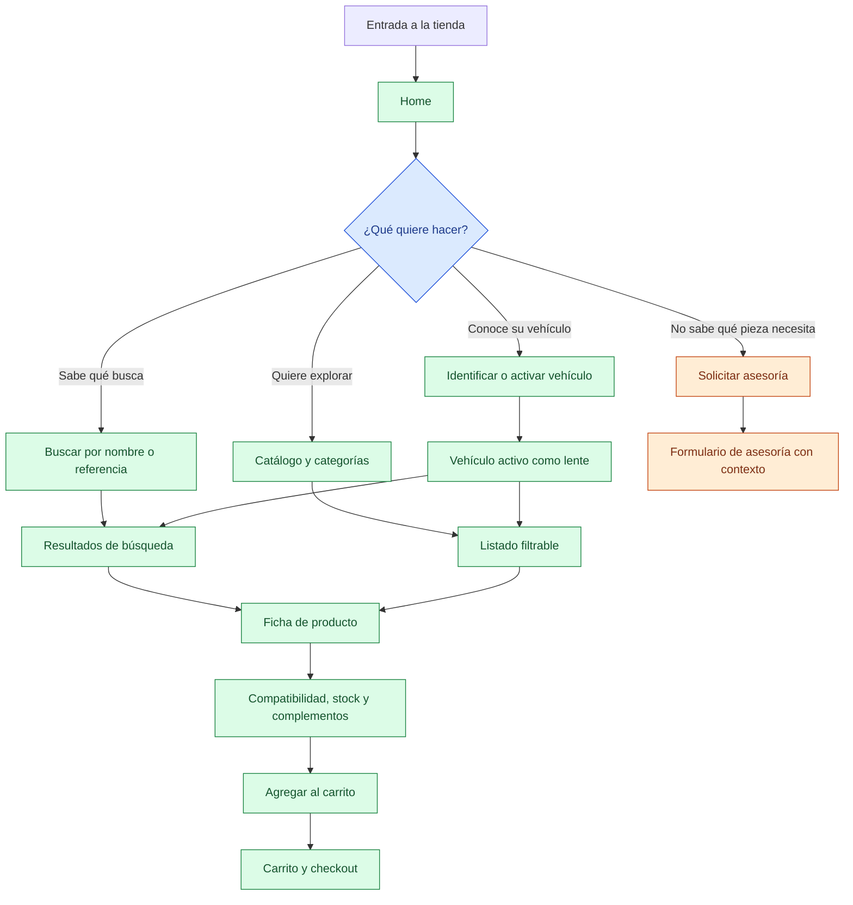

## 2. Selección y gestión del vehículo

**Épicas:** E07 y E08.  
**Estado actual:** placa y VIN son simulados; selección manual y garaje funcionan con `localStorage`.

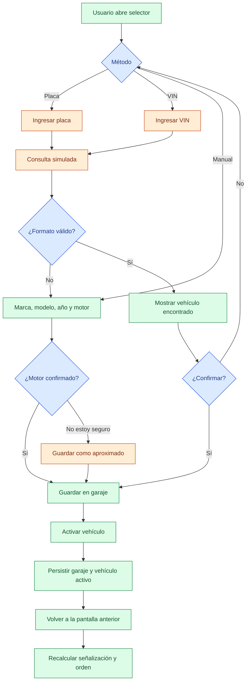

## 3. Búsqueda y descubrimiento

**Épicas:** E04, E05, E07, E40 y E54.  
**Estado actual:** búsqueda tokenizada, corrección tipográfica, sugerencias y priorización por compatibilidad funcionan sobre el catálogo local.

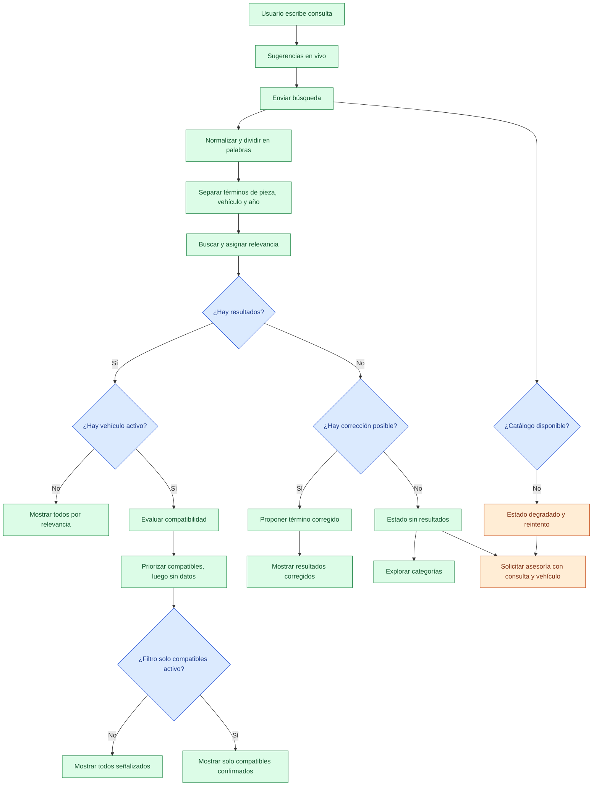

> **Diferencia pendiente:** en algunos resultados el texto afirma “Mostrando resultados compatibles” aunque el sistema solo los está priorizando y el filtro exclusivo está apagado.

## 4. Evaluación de compatibilidad

**Épicas:** E06, E07 y E42.  
**Regla documental:** aplicabilidad es un dato del producto; compatibilidad es una evaluación contra el vehículo activo.

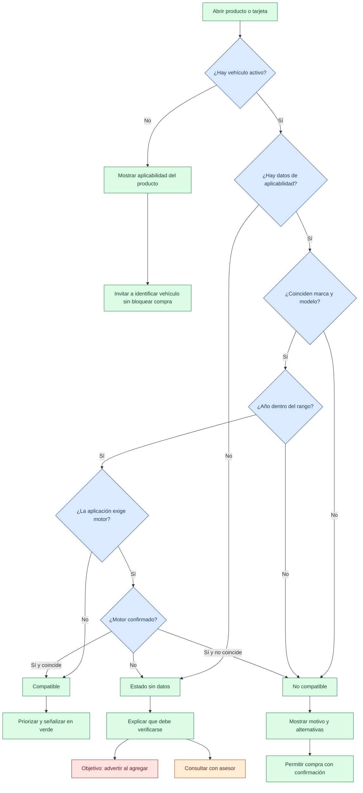

> **Brechas actuales:** el estado `unknown` se agrega al carrito sin una confirmación específica; la lista de aplicaciones puede marcar “Tu vehículo” comparando solo marca y modelo, aunque el año no coincida.

## 5. Ficha de producto y decisión de compra

**Épicas:** E06, E07, E10, E13, E14, E29 y E55.

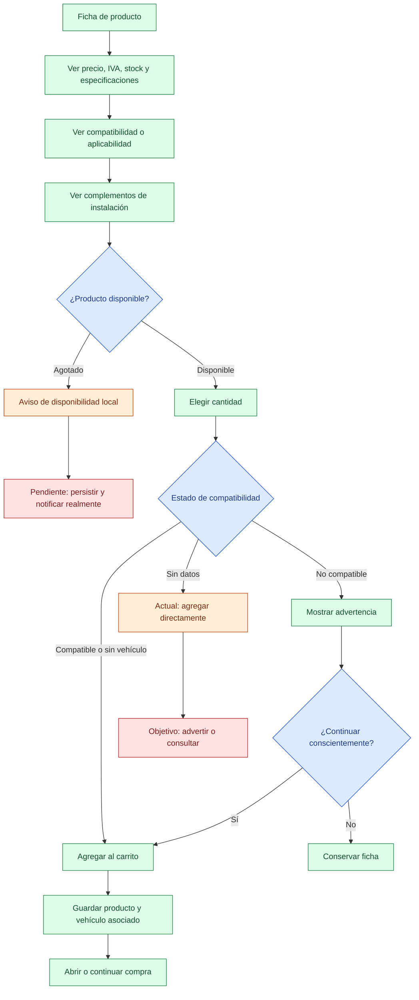

## 6. Complementos necesarios para la instalación

**Épica:** E55.  
**Estado actual:** mock curado de algunas relaciones; no existe fuente operativa ni dueño del dato.

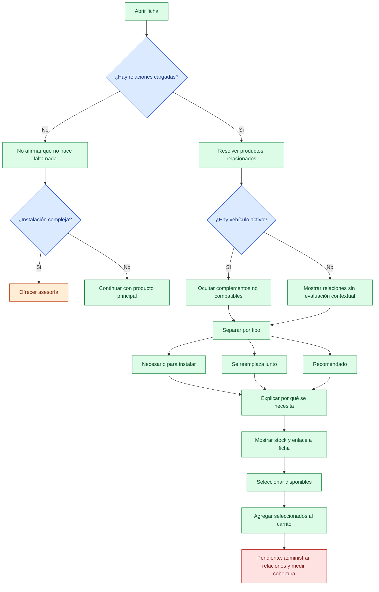

## 7. Asesoría asistida y transferencia de contexto

**Épicas:** E21, E22 y E54.  
**Estado actual:** flujo local funcional para demostración; no envía la solicitud a un canal externo.

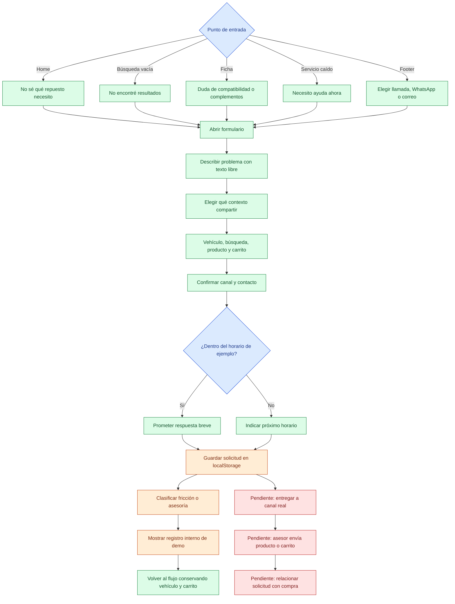

## 8. Carrito y checkout actual

**Épicas:** E10, E11, E15 y E18.  
**Estado actual:** pedido local pendiente; no existe pago electrónico.

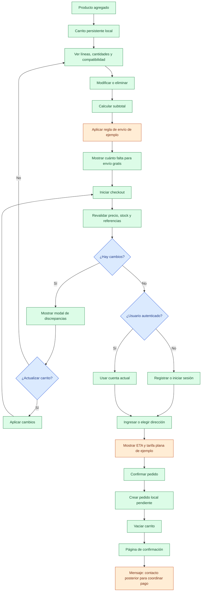

> **Brecha multivehículo:** el carrito asocia un vehículo a la línea, pero una misma referencia añadida para dos vehículos se fusiona por `product.id`; además, algunos snapshots no conservan el motor.

## 9. Checkout objetivo documentado

**Épicas:** E11, E12, E14, E15, E18, E20, E29, E34, E35, E38 y E44.  
**Este flujo no está implementado; representa la dirección funcional que debe validarse con SIISA, PayU, Contabilidad y Logística.**

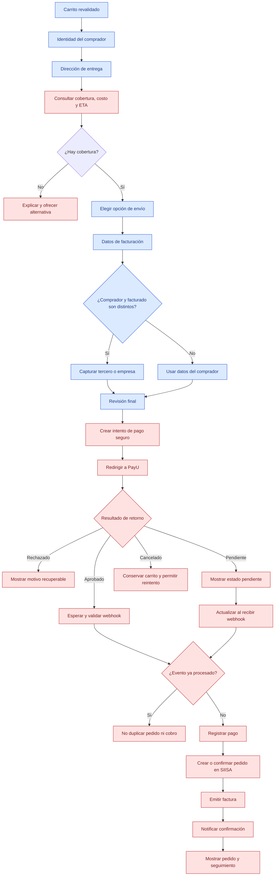

## 10. Estado degradado del catálogo

**Épicas:** E21, E40 y E54.

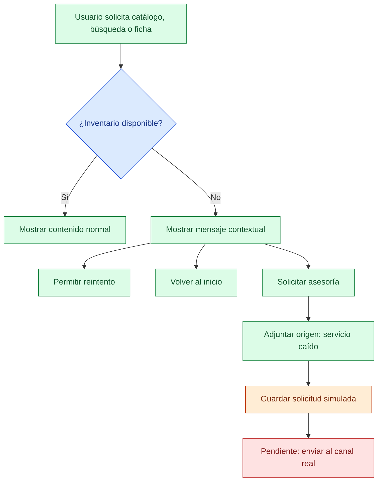

## 11. Dependencias externas del flujo completo

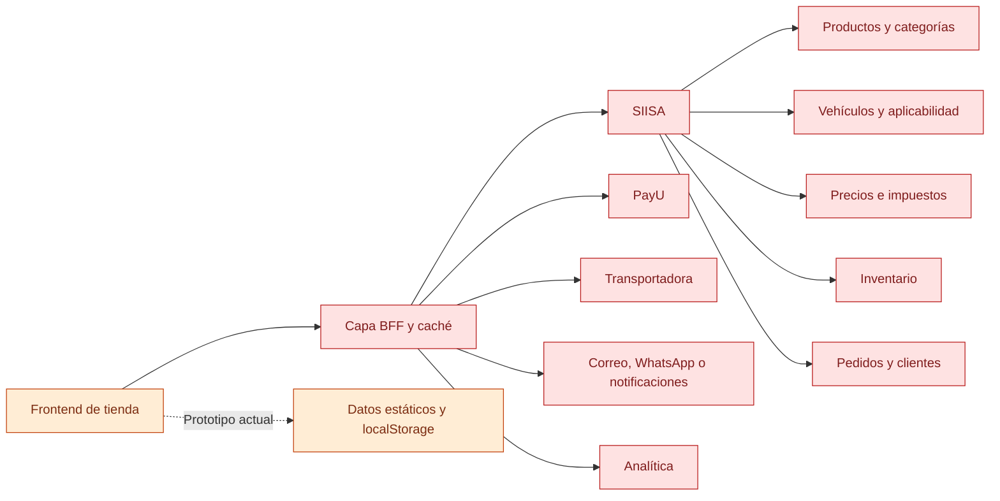

## Fuentes de Notion

- [Inicio del proyecto](https://app.notion.com/p/3c09daf513368171ab8bc1939a1ecb67)
- [Backlog de épicas](https://app.notion.com/p/9af76042414147af9ca71aef4677fe51)
- [Modelo conceptual de dominio](https://app.notion.com/p/3ca9daf51336818fa8f7f0202f3ab54f)
- [Decisiones pendientes](https://app.notion.com/p/3ca9daf513368122a7b3c6c9f1148fc2)
- [E07 · Compatibilidad](https://app.notion.com/p/3c09daf5133681eab44ef3a98fd91e26)
- [E10 · Carrito](https://app.notion.com/p/3c09daf5133681679a10c8d5aca8ab9f)
- [E18 · Envíos](https://app.notion.com/p/3c09daf5133681acbac6e99590816c6e)
- [E54 · Asesoría asistida](https://app.notion.com/p/3c59daf51336812b9c53d073dc0382f7)
- [E55 · Relaciones entre productos](https://app.notion.com/p/3c59daf5133681d9b90dc203b5ae089d)

## Nota de alcance

Notion mantiene estas épicas como **Sin empezar** porque el proyecto sigue registrado en Fase 0. Los nodos verdes de este documento indican cobertura navegable en el **prototipo**, no implementación productiva ni cierre de la épica.
