# Flujos del prototipo KGM Repuestos

> Estado de la rama `claude-notion` al 13 de octubre de 2026. Solo lo que hoy está construido, tal como se comporta en pantalla. Cada ficha cuenta un recorrido corto, de arriba hacia abajo. No incluye lo que Notion define y todavía no existe.

**Cómo leerlos.** Trazo continuo: funciona de verdad en el navegador (la lógica y el guardado son reales). Trazo punteado: simulado, sin integración (SIISA, RUNT, PayU, correo, canal de asesoría). Hay una versión navegable en `diagramas-flujo.html`.

## 1. Mapa de pantallas

_Navegación_

El camino principal de una compra, de la portada al pedido.

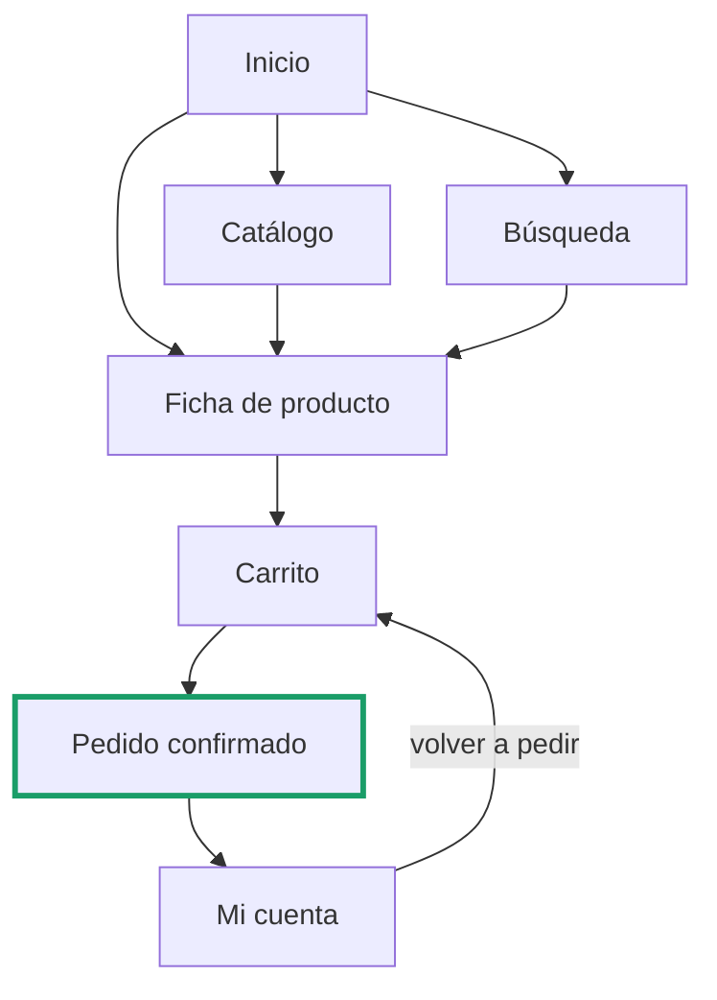

- **Dónde se guarda todo.** Vehículo, garaje, carrito, cuentas y pedidos viven en el navegador (`localStorage`). No hay servidor: cambiar de navegador o limpiar datos los borra.

## 2. Lo que está siempre a mano

_Navegación_

Siete accesos de la cabecera y el pie, disponibles en cualquier pantalla.

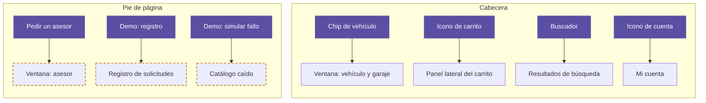

## 3. Identificar mi vehículo

_E01 · E08 - Placa y VIN simulados_

Se digita o se elige, sin fotos. La placa viene primero.

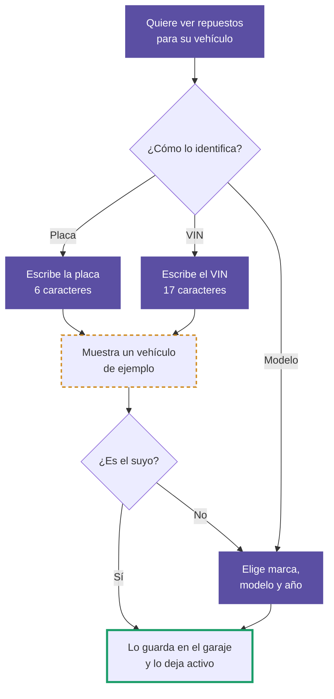

- **Dónde empieza.** En el panel de la portada o en el chip de la cabecera. La ventana de la cabecera suma una pestaña "por línea", el motor opcional y Mi garaje.
- **Si el dato no sirve.** Una placa de menos de 6 caracteres o un VIN de menos de 17 muestra un error y deja elegir otro método.
- **Simulado.** Cualquier placa o VIN válido en largo devuelve el mismo vehículo de ejemplo. No hay consulta a RUNT ni a SIISA.

## 4. Con un vehículo activo

_E07 · E08_

Qué cambia en la tienda y cómo se cambia o se quita.

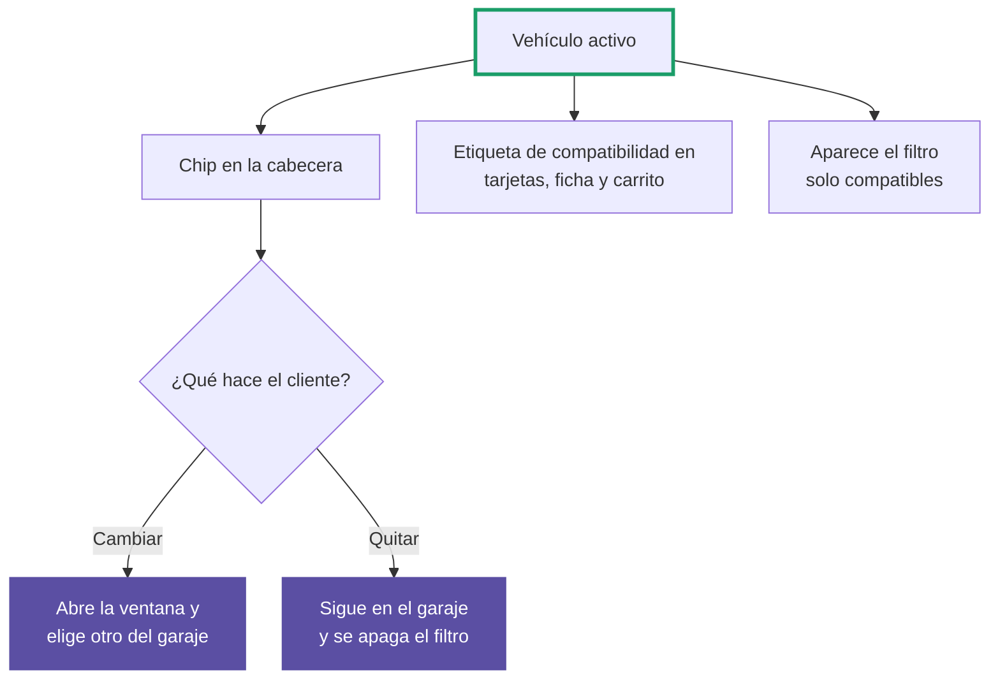

- **Sin vehículo la tienda no se bloquea.** Se ve todo el catálogo; solo desaparecen las etiquetas de compatibilidad.

## 5. Buscar un repuesto

_E04 · E05_

Desde el buscador de la cabecera, con ejemplos, sugerencias y corrección de tipeo.

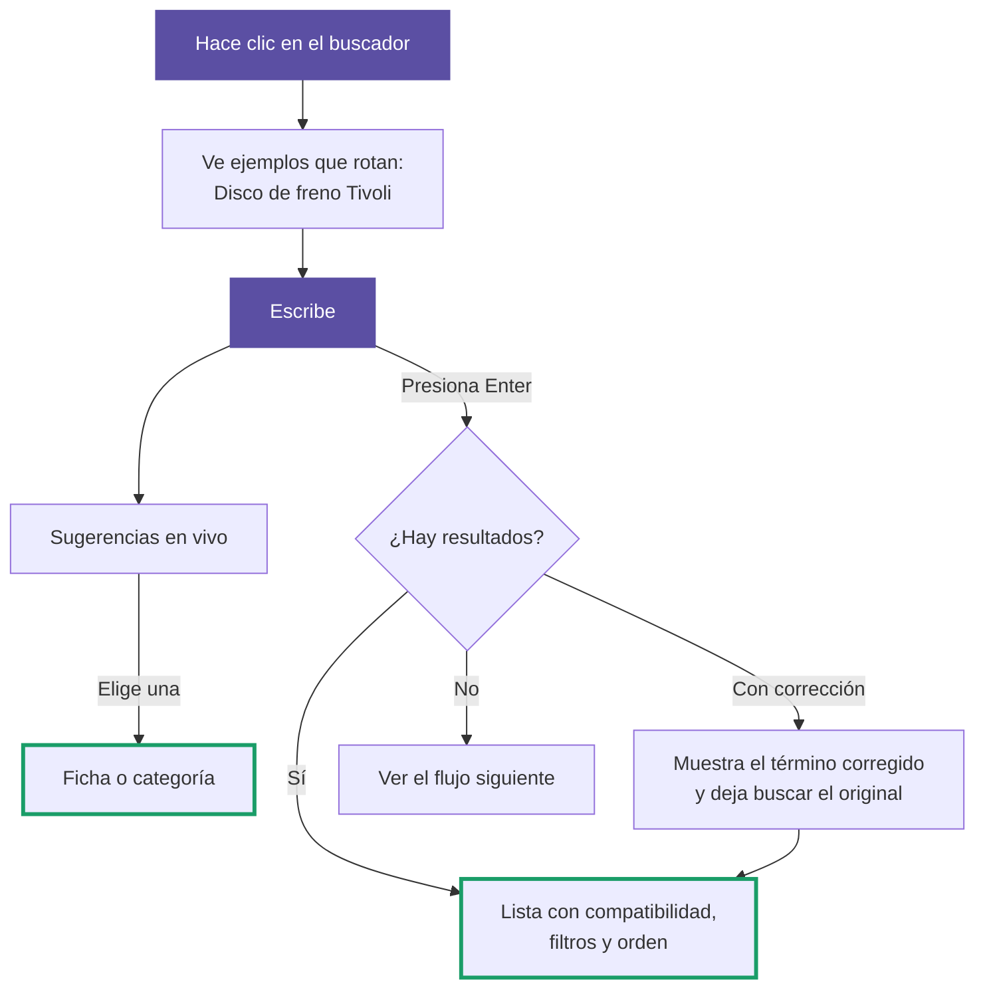

- **Con el catálogo caído** las sugerencias se apagan (último flujo).

## 6. Cuando no hay resultados

_E04 · E13 - Asesor simulado_

La búsqueda no termina en un callejón: ofrece salidas y deja constancia de lo que faltó.

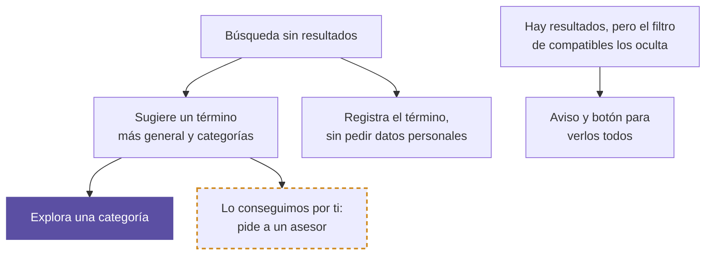

- **Demanda sin identidad.** Cada búsqueda sin resultados guarda término, fecha y vehículo activo. Se consulta agrupada en la pantalla de demo del registro.

## 7. Explorar el catálogo

_E02 · E03 · E05_

Por categoría o completo, con filtros combinables y 8 productos por página.

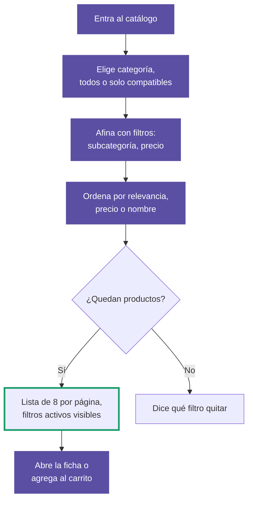

- **Relevancia.** Con vehículo activo, lo compatible va primero. Lo no compatible se señala, no se oculta.
- **En el celular** los filtros se abren en una capa a pantalla completa.

## 8. Cómo se decide la compatibilidad

_E07 · E10_

Tres resultados posibles. Sin vehículo activo no hay resultado, pero para qué vehículos sirve el repuesto siempre se ve.

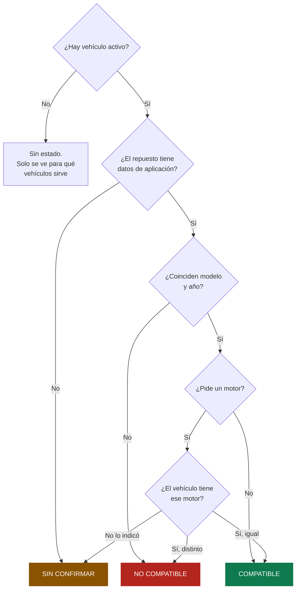

- **Dónde se ve.** Etiqueta con icono y texto en cada tarjeta; banner con el motivo en la ficha; fila marcada como tu vehículo en la tabla; estado por línea en el carrito, según el vehículo con que se agregó.
- **Sin confirmar nunca es rechazo.** El repuesto puede servir y solo falta el dato. Se ofrece verificarlo con un asesor.

## 9. Ficha de producto: qué se ve

_E06 · E07 - Asesor simulado_

El banner cambia según la compatibilidad; lo demás aparece siempre.

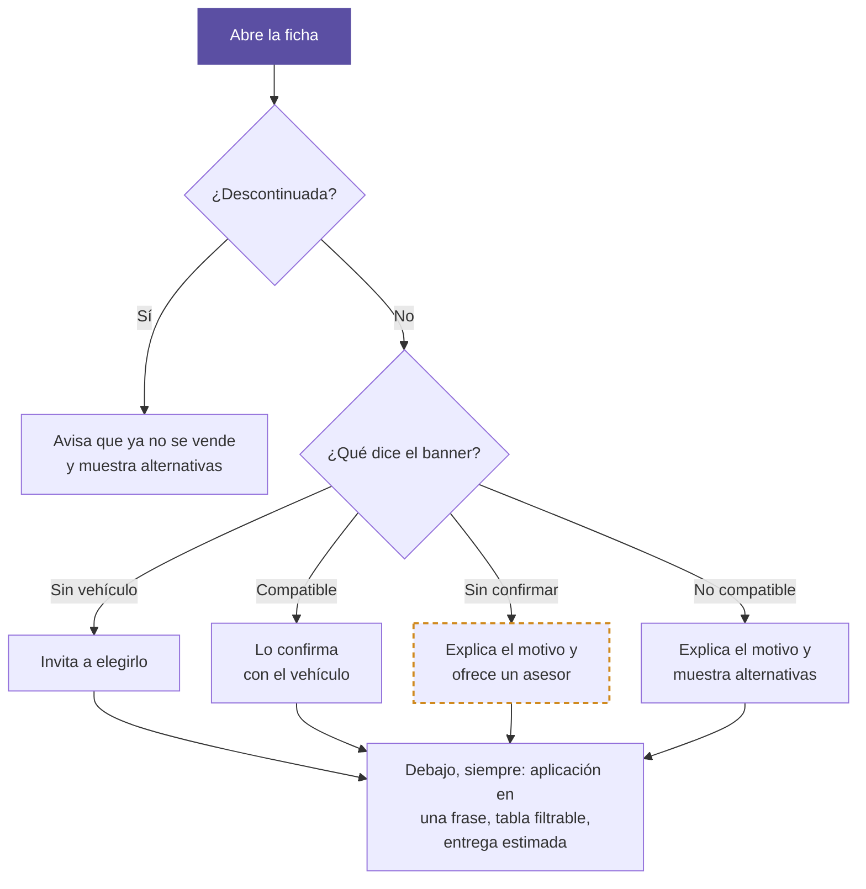

- **Pendiente de Notion.** La política de garantía y devoluciones está por definir (E19): la ficha lo dice en vez de afirmar plazos.

## 10. Ficha de producto: agregar

_E06 · E10 · E13 · E55 - Aviso y complementos simulados_

Del stock a la advertencia de compatibilidad, hasta el carrito.

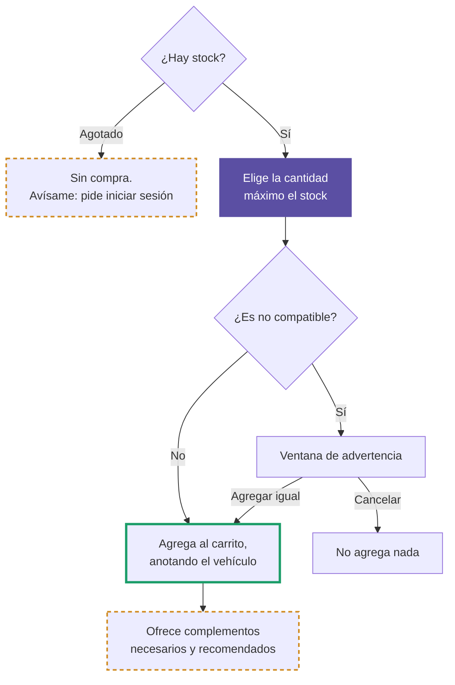

- **Sin confirmar no frena.** Solo "no compatible" pide confirmación antes de agregar; "sin confirmar" se agrega sin advertencia propia.
- **Simulado.** El aviso de disponibilidad no envía correo y los complementos son un maestro de ejemplo para pocos productos.

## 11. Compra: del carrito a los datos

_E10 · E11 · E18 - Valores de ejemplo_

Lo que se ve y se completa antes de confirmar.

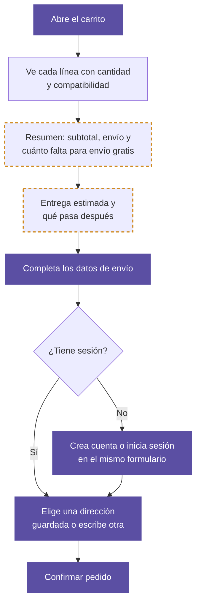

- **Valores de ejemplo.** Envío gratis desde $100.000, tarifa plana y entrega de 3 a 5 días hábiles son decisiones abiertas (D3, E18).

## 12. Compra: confirmar el pedido

_E11 · E15 · E17 - Sin pasarela de pago_

Antes de crear el pedido se revisa que nada haya cambiado. No se cobra: el cliente es contactado para coordinar el pago.

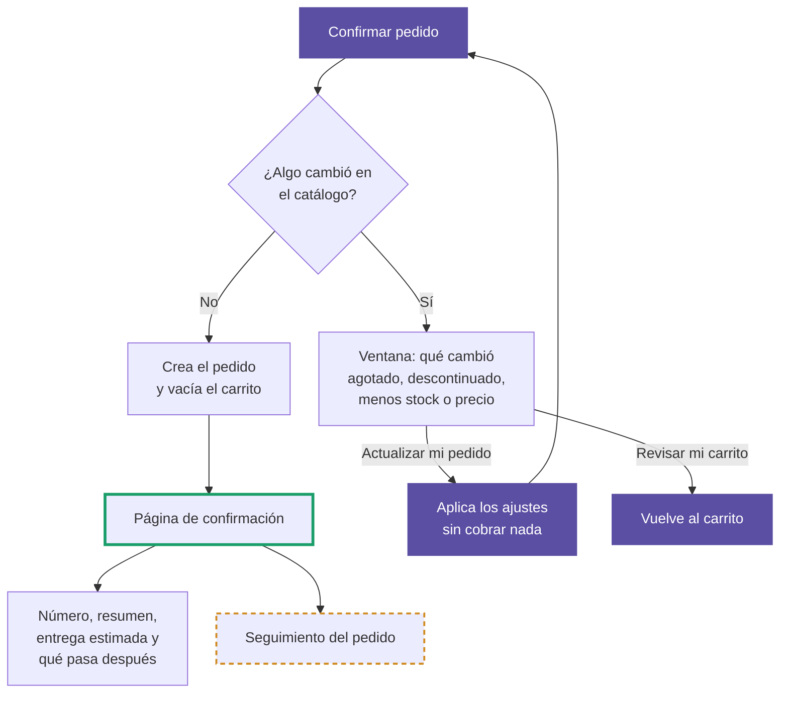

- **Lo real.** La revisión antes de confirmar, la cuenta creada en el checkout, las direcciones guardadas y el vehículo anotado en cada línea del pedido.

## 13. Entrar a mi cuenta

_E09 - Recuperación simulada_

Iniciar sesión, crear la cuenta o recuperar la contraseña.

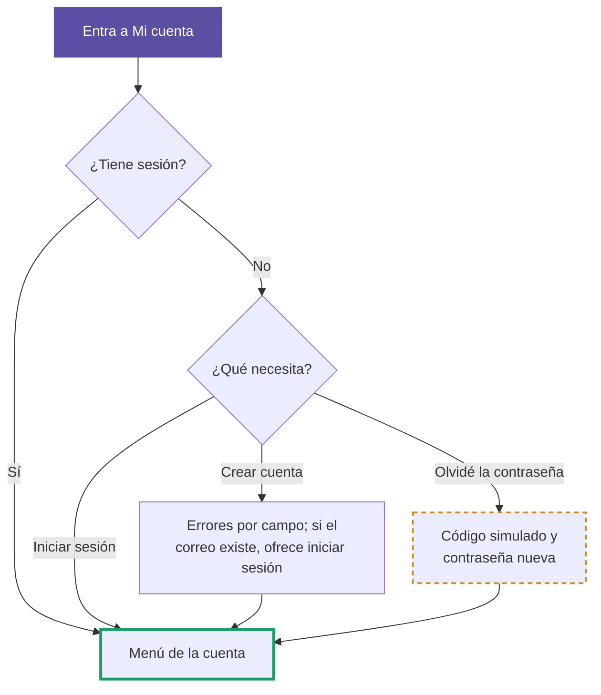

- **Contraseñas.** Se guardan en el navegador sin cifrar: es un prototipo, no un modelo de seguridad.

## 14. Dentro de mi cuenta

_E16 · E17_

Seis secciones; la de pedidos permite volver a pedir.

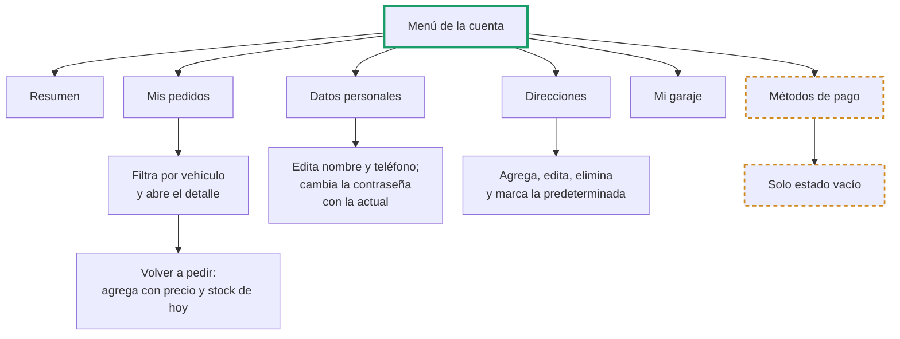

- **Volver a pedir.** Reintenta cada línea contra el catálogo de hoy y avisa qué no se pudo agregar y por qué.

## 15. Pedir ayuda a un asesor

_E54 · E21 · E22 - Simulado por completo_

El mismo formulario desde siete puntos, con el contexto de donde nació la solicitud.

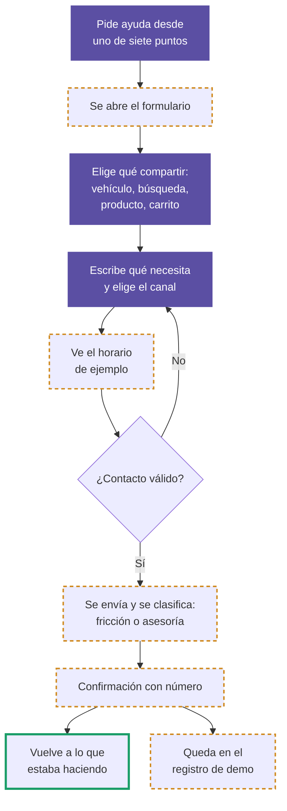

- **Los siete puntos.** Inicio, pie de página, búsqueda sin resultados, catálogo caído, duda de compatibilidad, repuesto sin alternativas y duda de complementos.
- **Fricción o asesoría.** Fricción es no encontrar algo o que algo falle; asesoría es necesitar criterio experto.
- **Sin canal real.** No hay bandeja, horario real ni mensaje enviado: la solicitud solo queda guardada en el navegador.

## 16. Cuando el catálogo no responde

_E02 - Interruptor de demo_

El pie de página trae un interruptor para mostrar este escenario.

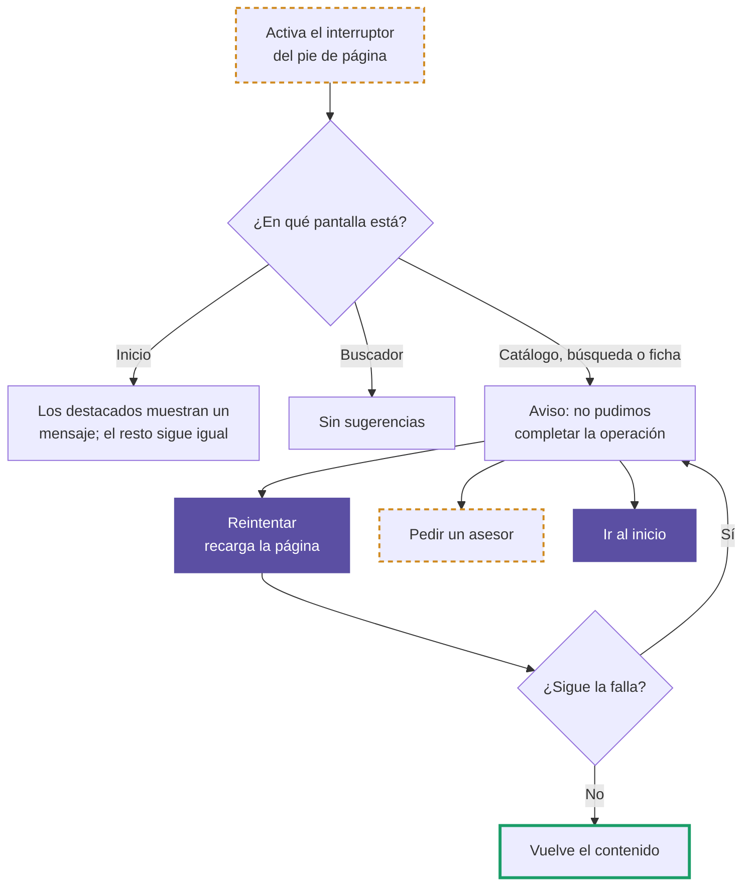

- **Origen.** La épica E40 no tiene historias escritas en Notion; este comportamiento se apoya en HU-E02-04 (saber que el catálogo no está disponible).

---

**Fuera de este mapa, a propósito:** pago real (PayU), conexión con SIISA, correos, back-office, política de garantía y devoluciones (E19), fidelización (E23), promociones y reseñas. No existen en el prototipo.

Donde difiera de las historias de usuario o del modelo conceptual de Notion, esos documentos mandan.
